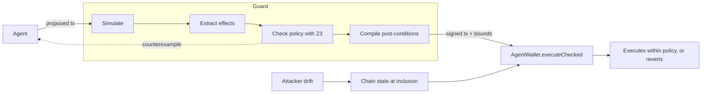

# Proof-Gated Signing

Proof-Gated Signing (PGS) is a transaction guard for AI agents that hold wallets.
Before a transaction is signed, it simulates it, uses the Z3 solver to prove the outcome meets a value and permission policy at every price in an oracle band, and derives bounds the wallet checks on-chain in the same atomic call.
If the chain changes between the check and execution, the transaction still meets the policy or it reverts.

This repository has the guard as a small Python library, a Solidity test wallet on a local Hardhat chain, and the testbed, experiments and results behind the paper [*Proof-Gated Signing: Solver-Checked Transaction Guards that Hold Under State Drift for Onchain AI Agents*](https://arxiv.org/abs/2610.00354) (arXiv:2610.00354, [PDF in this repo](paper/main.pdf)).

## The problem

The usual defense is to check a transaction before signing it. That can be an allowlist of known contracts, a second LLM that reviews the call, or a simulation that previews the outcome. All three share one weakness: they check the chain as it is *now*, but the transaction executes *later*. In between, an attacker can sandwich the trade, upgrade a contract the agent is about to call, or raise the transfer fee on a token it is sending. The check was correct, but the transaction that actually ran was different.

We call this **state drift**. In our experiments, a simulation-based guard missed every drift attack we tried.

## The idea

Proof-Gated Signing (PGS) turns the pre-signing check into something that still holds at execution time:

1. **Simulate** the proposed transaction on the current state.
2. **Extract its effects:** balance changes for every tracked asset, leftover token approvals, ownership of contracts the wallet controls, and what each payee actually receives.
3. **Check a policy with Z3**, for every price inside the oracle's uncertainty band. Example policy: lose at most 3% of what you send, at most $5k per session, and pay only approved recipients. If the check fails, the solver returns a concrete counterexample.
4. **Compile post-conditions.** Derive bounds such as "the wallet must end up with at least X WETH" and "Alice must receive at least Y USDC", then have the solver prove that *any* outcome within those bounds satisfies the policy.
5. **Enforce them on-chain.** The wallet runs the transaction and checks the bounds in the same atomic call. If anything drifted far enough to break a bound, the whole transaction reverts.



So if the chain changes between check and execution, the transaction either still respects the policy or it doesn't happen.

This is related to slippage protection (`minOut`), but it goes further. A `minOut` covers one token of one swap, and the agent, which may be the compromised party, sets it. PGS derives its bounds independently and covers every tracked asset, payee receipts, approvals and ownership. The bounds also come with a proof that they imply the wallet-level policy.

## Results

We ran 260 scenarios on a local chain: 14 attack families and 12 kinds of normal activity, 10 randomized variants each. An attack counts as successful only if attacker-controlled accounts actually gained value. That rule is independent of the policy being tested.

| Defense | Attacks prevented | Normal transactions allowed | Total attacker gain |
|---|---|---|---|
| No guard | 0% | 100% | $12.18M |
| Static allowlist | 71.4% | 83.3% | $558k |
| Simulation only | 57.9% | 97.5% | $855k |
| PGS without payee receipt checks | 86.4% | 97.5% | $80k |
| **PGS** | **93.6%** | **97.5%** | **$42k** |

These rates are for this suite of 140 attacks and 120 normal scenarios, which we designed ourselves. They show which mechanisms stop which kinds of attack. They are not an estimate of real-world performance.


Main observations:

- **Drift is what simulation misses.** The simulation-only guard missed all 50 drift scenarios. Under PGS, all 50 ended with no attacker gain. Forty reverted on-chain. In the other ten, an attacker who read the guard's bounds from the mempool found nothing profitable to do within them.
- **A clean simulation can mislead a reviewer.** An LLM judge given the (pre-drift) simulation approved a malicious contract upgrade 5 times out of 5, compared with 2 out of 5 without it.
- **Payments need their own check.** Without receipt checks, a fee-on-transfer token skimmed 30–90% of payments and none were blocked. With them, all ten reverted.
- **One attack is bounded, not prevented.** An attacker who drains slowly, keeping every step inside policy, was capped by the session budget: at most $4.76k against a $5k limit, versus up to $10.8k unguarded.
- **LLM wallet agents resisted most injections on their own.** We tested Claude Opus and Haiku. What got through was a fake bridge, which looks legitimate at the call level. PGS blocked it.
- **Cost:** about 41k extra gas per transaction and 0.1–0.2 s per check.

The full breakdown by attack family, with confidence intervals and the LLM-judge comparison, is in the paper.

## Install

You need Python 3.11 and Node.js 22 LTS (Hardhat 2.29.1 supports Node 20, 22 and 24; CI uses 22).

```bash
git clone https://github.com/Cygnux-Labs/Proof-Gated-Signing && cd Proof-Gated-Signing
python3.11 -m venv .venv && . .venv/bin/activate
pip install -r requirements.txt   # exact versions; the file says how they were chosen
npm ci                            # Hardhat 2.29.1 and solc 0.8.26, from package-lock.json
node compile.js                   # rebuilds build/artifacts.json; the output matches the committed file
python -m pytest                  # 22 tests; starts and stops its own Hardhat node
```

To use only the library in another project: `pip install git+https://github.com/Cygnux-Labs/Proof-Gated-Signing` (it needs `web3` and `z3-solver`).

## Use it as a library

One call decides on one batch of calls the wallet would make:

```python
import pgs

policy = pgs.Policy(
    prices={"USDC": 1.0, "WETH": 2500.0, "ETH": 2500.0},    # nominal USD prices; "ETH" is the native coin
    assets={"USDC": usdc, "WETH": weth},                    # token addresses (checksummed)
    band=0.005,                                             # true prices are within +-0.5%
    max_rel_loss=0.03, floor_usd=25.0, window_usd=5000.0,   # lose at most 3% + $25 per batch, $5k per session
    payees={alice: 20_000.0},                               # who may be paid, and up to how much per batch
    trusted_spenders={pool},                                # who may keep an allowance
    owned=[vault])                                          # contracts whose owner() must stay the wallet
chain = pgs.Web3Chain(w3, wallet=wallet, sender=agent)      # the state provider
session = pgs.Session()                                     # loss so far, against window_usd

calls = [{"target": usdc, "value": 0, "data": "0x095ea7b3..."}, ...]   # what the agent proposes
v = pgs.check(policy, calls, chain, session)
if v.allow:
    batch = [(c["target"], c["value"], bytes.fromhex(c["data"][2:])) for c in calls]
    wallet_contract.functions.executeChecked(batch, *v.post).transact({"from": agent})
    session.record(realized_loss_usd, v.effects)            # after it executes: value lost net of payments
else:
    print(v.reasons, v.counterexample)
```

`pgs.check(policy, calls, chain, session=None, mode="sim+assert")` returns a `Verdict`:

| Field | What it holds |
|---|---|
| `allow` | whether the guard would sign |
| `reasons` | why it refused, for example `eoa-recipient-not-allowlisted:0x…` or `value-policy:{…}` |
| `post` | the bounds: balance, allowance, owner and receipt checks, the four arrays `AgentWallet.executeChecked` takes (`None` if refused, or in `mode="sim"`) |
| `proof` | the SMT-LIB query Z3 found unsat: the bounds (or, in `mode="sim"`, the simulated outcome) imply the policy at every price in the band. Any SMT solver can recheck it |
| `counterexample` | the solver's counterexample when the policy or the bounds fail, for example `{"violated": "relative-loss", "loss_usd": 1000.0}` |
| `effects` | what the simulation did: balance changes, allowances, owners, payments |

Malformed calls or policies raise `ValueError` before the chain is touched. `pgs.prove(policy, box, exact, payments)` runs the solver step alone, with no chain. `pgs.Web3Chain` needs a node with `evm_snapshot`/`evm_revert` and an unlocked `sender` (tested on Hardhat); any object with the same methods can replace it (see `pgs/chain.py`). The wallet must implement `executeChecked` like `AgentWallet` in `contracts/Testbed.sol`.

[`examples/check_tx.py`](examples/check_tx.py) runs this against the local chain: an allowed swap with its bounds, a refused payment with its counterexample, and a front-run that makes the wallet revert the swap.

```console
$ ./node.sh 8545 && python examples/check_tx.py --port 8545
up
swap 10,000 USDC -> WETH: allowed
  bound: wallet USDC changes by at least -10,000.0000
  bound: wallet WETH changes by at least 3.9442
  bound: wallet ETH changes by at least 0.0000
  proof: 35 lines of SMT-LIB that Z3 found unsat
transfer 1,000 USDC to an unknown address: refused
  reasons: eoa-recipient-not-allowlisted:0x3C44CdDdB6a900fa2b585dd299e03d12FA4293BC | counterexample: {'violated': 'relative-loss', 'loss_usd': 1000.0}
after drift: the wallet reverted the swap on-chain: True
```

## Reproduce the paper

After [Install](#install). `./node.sh PORT` starts a Hardhat node, or restarts it if one is already running there (Linux and macOS). Outputs go to `/tmp` so the committed `results/` stay as they are.

```bash
# Tables 3 and 4, Fig. 2, the 1,300 runs and the gas overhead (about 8 minutes)
./node.sh 8545
python eval/run.py --variants 10 --port 8545 --committed-nonces --out /tmp/runs.jsonl --judge-out /tmp/judge_inputs.json
python eval/compare.py /tmp/runs.jsonl                           # 1300/1300 runs identical (all fields but latency_s)
python eval/summarize.py /tmp/runs.jsonl /tmp/summary.json       # tables, confidence intervals, gas
diff <(grep -v latency results/summary.json) <(grep -v latency /tmp/summary.json)   # no output

# Session study: 183/200 with price restoration, 155/200 without
./node.sh 8545 && python eval/session.py --port 8545 --sessions 5 --length 40 --arb --out /tmp/benign_sessions_arb.json
./node.sh 8545 && python eval/session.py --port 8545 --sessions 5 --length 40 --out /tmp/benign_sessions.json
cmp /tmp/benign_sessions_arb.json results/benign_sessions_arb.json && cmp /tmp/benign_sessions.json results/benign_sessions.json

# LLM wallet-agent episodes: replay of the recorded proposals under each defense
./node.sh 8545 && python agent/eval_episodes.py --port 8545 --out /tmp/agent_episodes.jsonl
cmp /tmp/agent_episodes.jsonl results/agent_episodes.jsonl
```

`--committed-nonces` starts the deployer at nonce 188 and the attacker at nonce 19, as on the node that produced `results/runs.jsonl`, where earlier runs had used those nonces (one world build takes 47 deployer transactions; 188 is four builds). Contract addresses then match the committed run. Without it, on a fresh node, 180 of the 1,300 runs differ from the committed file: 90 only in contract addresses inside reason strings, 90 by a few units of gas (calldata costs depend on the zero bytes in an address). No decision, harm label or attacker gain changes. `judge_inputs.json` can differ in key order only: it comes from iterating a set, which depends on Python's hash seed.

Not reproducible offline: the LLM-judge comparison (Table 5, Fig. 3) needs model calls (`eval/judge_batches.py`, `eval/judge_prompt.md`); its inputs and outputs are in `results/judge/` and `results/v1/summary_llm.json`. Latency depends on the machine (the paper: 163 ms median on a shared 2-vCPU container; 50-65 ms on an Apple-silicon Mac). `python eval/figures.py` regenerates the figures into `paper/figs/`.

## Limits

What the paper's Theorem 1 guarantees, for a batch that executes through `executeChecked`:

- the value policy on tracked assets, for every price in the oracle band;
- credited payees receive at least the credited amount;
- checked allowances don't exceed their simulated values;
- owned contracts keep their owner;
- all of the above under any state change between the check and execution.

Bounded, not prevented:

- **Losses that stay within the per-batch policy** (fees, slow in-policy drains): only the session budget caps them.
- **Drift smaller than the post-condition tolerance** (1% of the inflow by default) plus the price band.

Out of scope, as the paper states (Table 1 and Section 6):

- **Untracked assets**, such as NFTs or positions without a balance view. Unpriced token flows are refused instead.
- **Off-chain signatures** such as permits, which never pass through the transaction path.
- **ETH sent to EOAs by internal calls, and allowances never observed**: these are checked on the simulation only.
- **A wrong policy, a wrong oracle band, or a dishonest tracked token**: these are trusted inputs.
- **An agent that holds the signing key** and calls the unguarded path. The deployment must give key custody to the guard.
- **Real-world rates.** The testbed is a simplified local chain (constant-product pools, a static oracle) with attacks we wrote. The rates describe this suite, not real-world performance.

In this code:

- Key custody isn't built. In the testbed the agent's account owns `AgentWallet`, and both `execute` (unguarded) and `executeChecked` accept it. An ERC-4337 validator that enforces custody on-chain is the paper's future work.
- The contracts in `contracts/Testbed.sol` are unaudited test contracts. Run them on a local chain only, never with keys or funds that have value.
- Prices are static numbers in the policy. There is no oracle.
- An EOA is an address with no code. An EIP-7702-delegated EOA has code, so the "value to EOAs only to payees" check treats it as a contract. The value policy still counts the outflow as a loss.
- The match between the Z3 encoding and the Solidity checks is checked by hand and by tests (`tests/test_api.py` samples Theorem 1 on real verdicts), not machine-proved.

## Layout

```
contracts/Testbed.sol   tokens, pools, vault, attack contracts, and AgentWallet.executeChecked
pgs/guard.py            the method: check, simulate, prove; Policy, Session, Verdict
pgs/chain.py            Web3Chain, the state provider for a Hardhat (or similar) node
pgs/scenarios.py        attack and benign scenario families
pgs/defenses.py         baselines, and PGS through pgs.check
pgs/world.py            deploys the test world
tests/                  pytest tests of the library
examples/               the library example
eval/                   experiment runners, summaries, figures, LLM-judge prompt, compare.py
agent/                  CLI and episodes for the LLM wallet agents
results/                raw per-run logs and summaries
paper/                  LaTeX source and PDF
```

## Citation

If you use PGS, please cite the paper (also in [CITATION.cff](CITATION.cff)):

```bibtex
@misc{ghosh2026proofgated,
  title         = {Proof-Gated Signing: Solver-Checked Transaction Guards that Hold Under State Drift for Onchain AI Agents},
  author        = {Ghosh, Bravish},
  year          = {2026},
  eprint        = {2610.00354},
  archivePrefix = {arXiv},
  doi           = {10.48550/arXiv.2610.00354},
  note          = {Preprint}
}
```

## License

Apache License 2.0, © 2026 Cygnux Labs. See [LICENSE](LICENSE) and [NOTICE](NOTICE).
